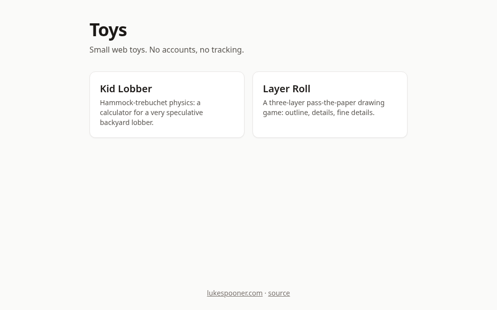
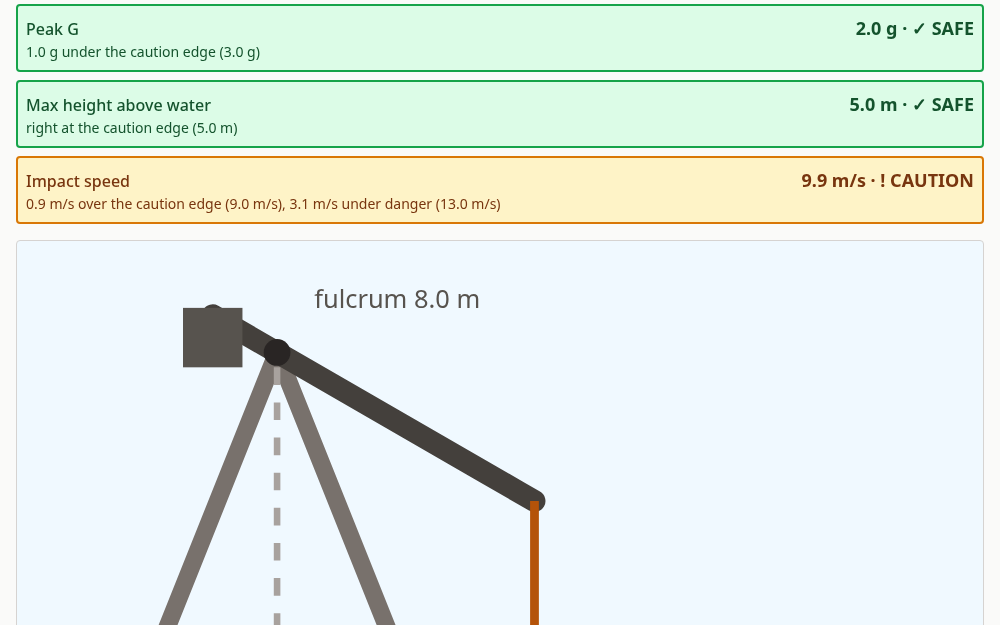
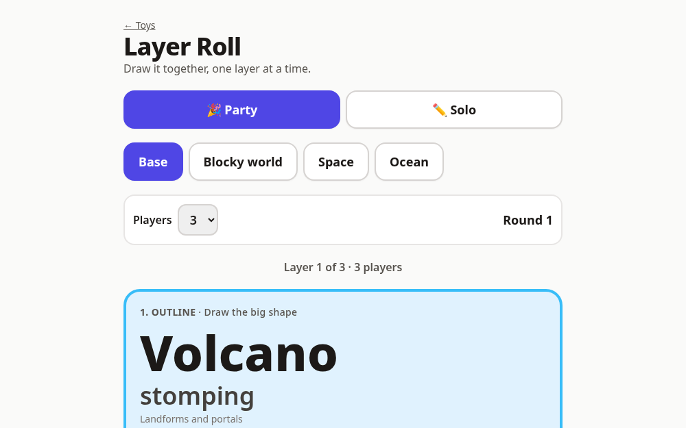

# web-toys

Small, static web toys by Luke Spooner, live at **https://toys.lukespooner.com**. No backend, no accounts, no trackers, no external fonts.



## The toys

### Kid Lobber: [toys.lukespooner.com/trebuchet](https://toys.lukespooner.com/trebuchet/)
A simplified hammock-trebuchet physics calculator. Set arm, counterweight, sling and fulcrum, and get a landing zone plus Peak G, max height and impact speed readouts with SAFE / CAUTION / DANGER bands and a side-view diagram. It is a rough-estimate toy: never launch a person, test only with sandbags. Spec: [docs/SPEC-trebuchet.md](docs/SPEC-trebuchet.md).



### Layer Roll: [toys.lukespooner.com/layers](https://toys.lukespooner.com/layers/)
A three-layer pass-the-paper drawing game: roll an outline, mid details and fine details, draw one layer each, and pass the paper. Party and solo modes, optional theme packs, seeded rolls via `?seed=`. Spec: [docs/SPEC-layer-roll.md](docs/SPEC-layer-roll.md).



## Run locally

Needs Node 22.

```sh
npm ci
npm run dev      # dev server
npm test         # node --test
npm run build    # static site in dist/
npm run preview  # serve dist/
```

Stack: Vite + React + Tailwind, multi-page build (one HTML entry per toy).

## IP note (Layer Roll)
Layer Roll's tables are original. It is inspired by the layered-prompt idea in Chuck Lukacs's *Fantasy Genesis*, but copies none of that book's word lists, layouts or text, and is not affiliated with it. The "Blocky world" theme is generic voxel-game flavor with no trademarked names, mobs or logos.

## License
[MIT](LICENSE).

Both toys started as one-off chat artifacts in 2025 that were never saved. `docs/reference/` keeps the last known source for reference only.
